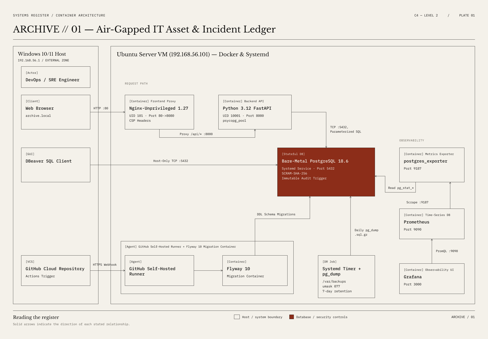
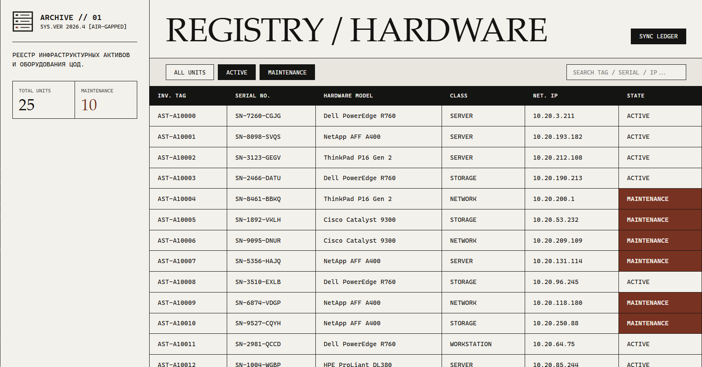
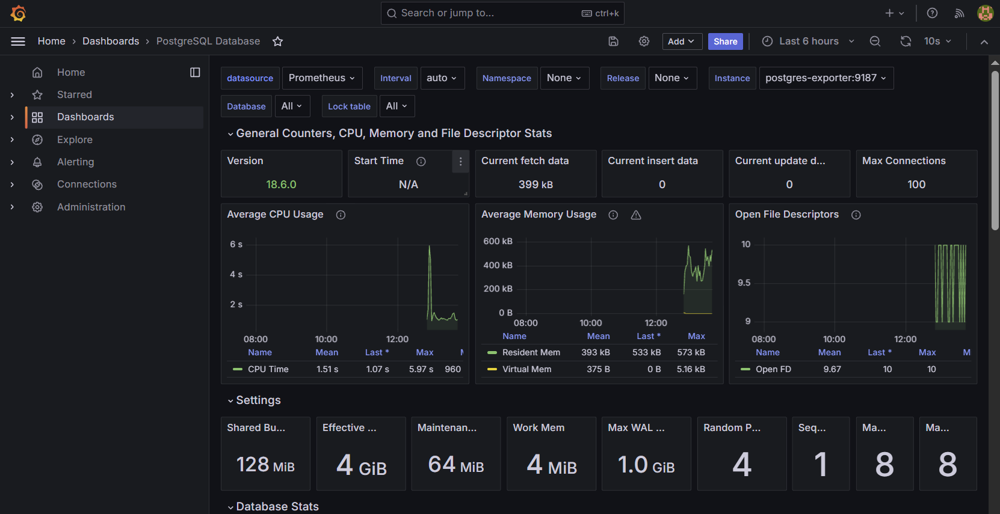

# ARCHIVE // 01 — Air-Gapped IT Asset & Incident Ledger


**[🌐 English Documentation](#-english-documentation) | [🇷🇺 Документация на русском](#-документация-на-русском)**

---

# 🌐 English Documentation

> **ARCHIVE // 01** is a production-grade, fault-tolerant IT Asset Management (ITAM) and Incident Tracking platform engineered with **DevSecOps**, **Database Reliability Engineering (DBRE)**, and **Air-Gapped Compliance** principles (zero external CDNs, zero Google Fonts, strict GDPR compliance).

## 1. System Architecture (C4 Model — Level 2)

Container & Hybrid Infrastructure register illustrating the request path, stateful PostgreSQL 18.6 isolation, automated Flyway DDL migrations, and Prometheus/Grafana observability pipeline:



---

## 2. Visual System & Real-Time Observability

### Swiss Brutalist Web Interface
Built on an exposed `1px solid #141413` structural grid, zero-latency system font stacks, and a flat 3-color archival palette (`#F4F1EA`, `#141413`, `#8C2D19`) with no gradients or shadows.



### Real-Time Database Observability (Grafana + Prometheus)
Live monitoring of the bare-metal PostgreSQL 18.6 cluster via `postgres_exporter`: active sessions, TPS, buffer cache hit ratio, locks, and I/O throughput.



---

## 3. DevSecOps & DBRE Engineering Highlights

| Layer | Implemented Practice | Security / Reliability Benefit |
| :--- | :--- | :--- |
| **Stateful Isolation** | Bare-metal PostgreSQL 18.6 on Ubuntu OS (Systemd) | Decouples critical data from stateless container lifecycles |
| **Immutable Audit** | PL/pgSQL trigger `prevent_audit_tampering()` | Blocks `UPDATE` and `DELETE` on `audit_logs` at the DB kernel level |
| **Authentication** | `scram-sha-256` hashing + `pg_hba.conf` & `UFW` rules | Prevents credential sniffing and unauthorized subnet access |
| **Container Hardening** | Multi-stage builds, non-root `UID 10001` & `UID 101` | Mitigates host privilege escalation vulnerabilities |
| **Web Security** | Strict `Content-Security-Policy`, `X-Frame-Options: DENY`, `textContent` | Eliminates XSS, Clickjacking, and external data leaks |
| **Schema Migrations** | Versioned SQL migrations via **Flyway 10** in CI/CD | Automated, repeatable DDL evolution directly from Git |
| **Disaster Recovery** | `backup_db.sh` (`umask 077`, `gzip -t`) + Systemd Timer | Daily verified backups with automated 7-day rotation |

---

## 4. Quickstart & Deployment Guide (EN)

### Step 1: Clone the Repository
```bash
git clone https://github.com
cd it-asset-tracker
```

### Step 2: Configure PostgreSQL & Apply Migrations
```bash
sudo -u postgres psql -c "CREATE DATABASE asset_tracker;"
sudo -u postgres psql -c "CREATE USER app_user WITH ENCRYPTED PASSWORD 'StrongPass_2026!';"
sudo -u postgres psql -d asset_tracker -c "GRANT CONNECT ON DATABASE asset_tracker TO app_user; GRANT USAGE, CREATE ON SCHEMA public TO app_user;"

docker run --rm --network host \
  -v "\${PWD}/database/migrations:/flyway/sql:ro" \
  flyway/flyway:10-alpine \
  -url=jdbc:postgresql://127.0.0.1:5432/asset_tracker \
  -user=app_user -password="StrongPass_2026!" migrate
```

### Step 3: Launch Application & Observability Stack
```bash
export DB_PASSWORD="StrongPass_2026!"
docker compose up -d --build
```

### Step 4: Enable Automated Backups (Systemd Timer)
```bash
tr -d \('\r' < scripts/backup_db.sh \vert{} sudo tee /usr/local/bin/backup_db.sh > /dev/null sudo chmod 700 /usr/local/bin/backup_db.sh tr -d '\r' < scripts/archive-backup.service \vert{} sudo tee /etc/systemd/system/archive-backup.service > /dev/null tr -d '\r' <\) scripts/archive-backup.timer | sudo tee /etc/systemd/system/archive-backup.timer > /dev/null
sudo systemctl daemon-reload
sudo systemctl enable --now archive-backup.timer
```

---
---

# 🇷🇺 Документация на русском

> **ARCHIVE // 01** — отказоустойчивая платформа учета серверного оборудования и инфраструктурных инцидентов (ITAM / Service Desk), спроектированная по стандартам **DevSecOps**, **Database Reliability Engineering (DBRE)** и **Air-Gapped Compliance** (полная автономность без внешних CDN и шрифтов Google).

## 1. Архитектура системы (Модель C4 — Уровень 2)

Архитектурный чертеж гибридной инфраструктуры (Windows Host <-> Ubuntu Server VM), отражающий маршрутизацию запросов, изоляцию базы данных PostgreSQL 18.6, пайплайн миграций Flyway 10 и контур мониторинга Prometheus/Grafana:


---

## 2. Ключевые инженерные решения

* **Изоляция базы данных (Stateful vs Stateless):** PostgreSQL 18.6 вынесен из Docker на уровень операционной системы Ubuntu (Systemd), что гарантирует сохранность данных при любых пересборках контейнеров.
* **Неизменяемый журнал аудита (Immutable Audit Trail):** таблица `audit_logs` защищена триггером `prevent_audit_tampering()`, блокирующим любые попытки удаления или модификации записей.
* **Безопасность контейнеров и веба:** запуск сервисов от непривилегированных пользователей (`UID 10001` и `UID 101`), параметризованные SQL-запросы, строгие заголовки `Content-Security-Policy` и отказ от `innerHTML`.
* **GitOps CI/CD:** автоматический накат миграций **Flyway 10** и пересборка контейнеров через **GitHub Self-Hosted Runner** при каждом пуше в ветку `main`.
* **Швейцарский брутализм:** открытая конструктивная сетка `1px solid`, системные шрифты с нулевой задержкой загрузки и адаптивность под любые экраны (Desktop / Mobile).

---

## 3. Инструкция по запуску с нуля (RU)

### Шаг 1: Клонирование репозитория
```bash
git clone https://github.com
cd it-asset-tracker
```

### Шаг 2: Инициализация БД и накат миграций Flyway
```bash
sudo -u postgres psql -c "CREATE DATABASE asset_tracker;"
sudo -u postgres psql -c "CREATE USER app_user WITH ENCRYPTED PASSWORD 'StrongPass_2026!';"
sudo -u postgres psql -d asset_tracker -c "GRANT CONNECT ON DATABASE asset_tracker TO app_user; GRANT USAGE, CREATE ON SCHEMA public TO app_user;"

docker run --rm --network host \
  -v "\${PWD}/database/migrations:/flyway/sql:ro" \
  flyway/flyway:10-alpine \
  -url=jdbc:postgresql://127.0.0.1:5432/asset_tracker \
  -user=app_user -password="StrongPass_2026!" migrate
```

### Шаг 3: Запуск контейнеров приложения и мониторинга
```bash
export DB_PASSWORD="StrongPass_2026!"
docker compose up -d --build
```

### Шаг 4: Активация автоматического резервного копирования (Systemd Timer)
```bash
tr -d \('\r' < scripts/backup_db.sh \vert{} sudo tee /usr/local/bin/backup_db.sh > /dev/null sudo chmod 700 /usr/local/bin/backup_db.sh tr -d '\r' < scripts/archive-backup.service \vert{} sudo tee /etc/systemd/system/archive-backup.service > /dev/null tr -d '\r' <\) scripts/archive-backup.timer | sudo tee /etc/systemd/system/archive-backup.timer > /dev/null
sudo systemctl daemon-reload
sudo systemctl enable --now archive-backup.timer
```

### Шаг 5: Доступ к сервисам
* **Веб-реестр оборудования:** `http://archive.local` (`http://192.168.56.101`)
* **Проверка статуса API:** `http://archive.local`
* **Панель Grafana:** `http://archive.local:3000` (Дашборд PostgreSQL ID `9628`)
* **Таргеты Prometheus:** `http://archive.local`
